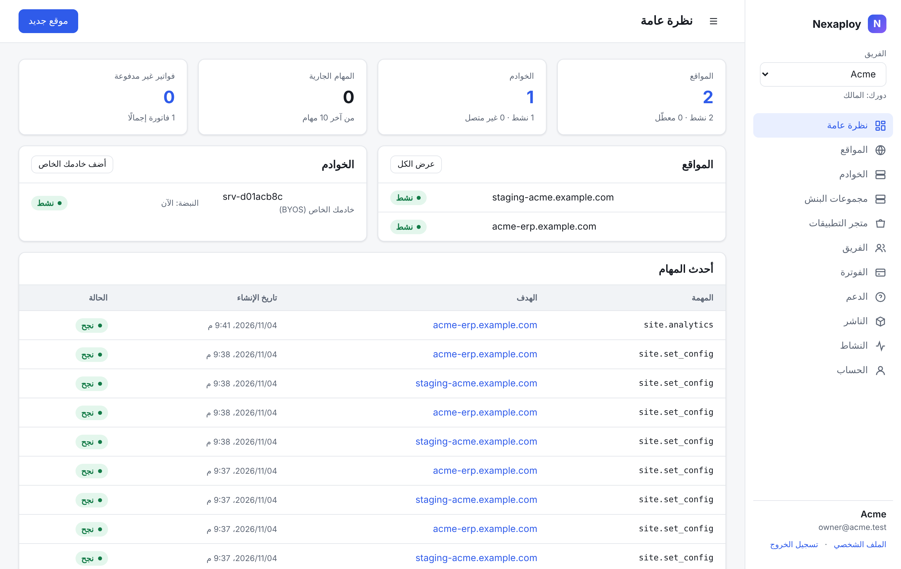

# Nexaploy

Nexaploy منصة لاستضافة **Frappe / ERPNext** وإدارتها، وهي بديل صغير ومركّز لـ Frappe Cloud.
يمكنك تشغيل مواقعك على خوادم تنشئها لك المنصة، أو **إحضار خادمك الخاص** (BYOS) لتديره Nexaploy.



## ماذا تقدّم

- **عدة إصدارات من Frappe جنبًا إلى جنب.** تعمل الإصدارات v14 وv15 وv16 على الخادم نفسه.
  لكل إصدار ومجموعة تطبيقات *بنش* (bench) خاص بها، يُبنى من *مجموعة إصدار* (Release Group)
  تحدد إصدار Frappe الرئيسي والتطبيقات.
- **المواقع.** يمكنك إنشاء المواقع وتثبيت التطبيقات وإضافة نطاقات مخصصة بشهادات TLS تلقائية،
  وتعديل إعدادات الموقع وترحيله ونسخه احتياطيًا واستعادته. يمكنك أيضًا إنشاء نسخ تجريبية
  (staging) وإعادة التسمية والنقل إلى بنش أو خادم آخر والترقية إلى إصدار Frappe أحدث والنقل إلى فريق آخر.
- **النسخ الاحتياطي** إلى تخزين متوافق مع S3، بجدول زمني أو يدويًا. لكل ملف بصمة تحقق، وتُحذف
  النسخ القديمة وفق مدة الاحتفاظ، وتحصل على روابط تنزيل قصيرة العمر.
- **سوق التطبيقات.** يحدد كل تطبيق إصدارات Frappe التي يدعمها. توجد تطبيقات مدفوعة وناشرون
  ومستحقات للناشرين. يمكنك أيضًا إضافة تطبيقاتك الخاصة من GitHub.
- **التشغيل.** مقاييس الخوادم والتنبيهات (القرص، انقطاع الاتصال، الحاويات غير السليمة) وفحص
  توفر المواقع، والتحديثات التلقائية ضمن نافذة زمنية. هناك أيضًا قياس استهلاك كل موقع مع
  حدود الخطة، والسجلات وتحليلات الطلبات والاستعلامات البطيئة وSQL للقراءة فقط وطرفية (console).
- **الفوترة والفرق.** الخطط والفواتير وStripe وPaymob والرصيد المسبق الدفع. للفرق أدوار
  وتحقق بخطوتين وسجل نشاط ومفاتيح API. لوحة تحكم العميل متاحة بالعربية والإنجليزية.

## كيف تترابط الأجزاء

```
 control plane (Frappe app "nexaploy")          your servers (hosted or BYOS)
 ┌──────────────────────────────────┐           ┌──────────────────────────────────────┐
 │ desk + customer dashboard        │  HTTPS    │ nexaploy-agent (API + worker)        │
 │ Agent Jobs ◄── poll / job_update ├◄──────────┤ Docker: Traefik · MariaDB 11.8       │
 │ heartbeat (facts, usage)         │ outbound  │ benches (one per Release Group)      │
 └──────────────────────────────────┘   only    │   └─ sites (own DB, files, domains)  │
                                                 └──────────────────────────────────────┘
```

- **لوحة التحكم المركزية** (control plane) تطبيق Frappe. تحفظ الخوادم ومجموعات الإصدار والبنشات
  والمواقع والنسخ الاحتياطية والخطط والفواتير. لا تتصل بأي خادم أبدًا.
- على كل خادم يعمل **الوكيل** `nexaploy-agent`. الوكيل هو من يبدأ الاتصال دائمًا: يرسل نبضة
  دورية ويطلب المهام وينفذها خطوة بخطوة ثم يبلّغ بالنتيجة. لا يحتاج الخادم **أي منافذ واردة
  غير 80/443** لمواقعه، ولا تحتاج المنصة إلى SSH.
- كل ما على الخادم موجود في `/opt/nexaploy`. هناك قاعدة MariaDB مشتركة واحدة (`mariadb:11.8`)
  ووكيل Traefik واحد. كل بنش مشروع Docker Compose مستقل.
- **بلا احتجاز.** إذا أزلت الوكيل تبقى البنشات والمواقع وقاعدة البيانات والوكيل العكسي تعمل.

## إلى أين بعد ذلك

- **[دليل المشغّل](guide/operator.md)**: لصاحب المنصة. التثبيت (على خادم واحد أو لوحة مستضافة مع خوادم
  BYOS)، ومنطقة الإدارة، والأسعار والدفع، والتخزين، والبريد، والعلامة التجارية، وإصدارات الوكيل، وصحة
  الخوادم وتحديثات النظام، والعمليات اليومية، والتعافي من الكوارث، وسطر الأوامر.
- **[دليل العميل](guide/customer.md)**: للعملاء. الفرق والخوادم ومجموعات البنش والمواقع والتطبيقات
  والنطاقات والنسخ الاحتياطي والاستعادة والتحديث الآمن والمراقبة والإشعارات والفوترة والدعم.
- [البدء السريع](quick-start.md): كل شيء على خادم واحد، أو لوحة تحكم مستضافة مع خوادم BYOS.
- [مرجع التثبيت](install.md): كل خيارات `install.sh`.
- [التشغيل](operating.md): النسخ الاحتياطي والتحديثات وترقية الوكيل ونقل المواقع وإصدارات Frappe.
- [حل المشكلات](troubleshooting.md): TLS والمنافذ وMariaDB والقرص والمهام الفاشلة والسجلات.
- [نموذج الأمان](security.md) و[الأسئلة الشائعة](faq.md).

## ميزات جديدة { #new }

يوضح كل سطر ما تفعله الميزة، وطريقة استخدامها مشروحة في [دليل المشغّل](guide/operator.md)
و[دليل العميل](guide/customer.md).

| الميزة | ماذا تفعل |
|---|---|
| **التثبيت الشامل (all-in-one)** | يثبّت `install.sh --with-control-plane <domain>` لوحة التحكم والمواقع على خادم واحد. |
| **الإشعارات / Telegram** | ترسل التنبيهات ونتائج المهام إلى Telegram وقنوات أخرى، لا بالبريد الإلكتروني فقط. |
| **نسخ احتياطي إلى Google Drive / OneDrive** | تتيح حفظ النسخ الاحتياطية في Google Drive أو OneDrive إلى جانب S3. |
| **التحقق من DNS** | تتحقق من أن النطاق المخصص يشير إلى الخادم الصحيح قبل طلب شهادة TLS. |
| **الاستعادة إلى لحظة محددة (PITR)** | تستعيد قاعدة بيانات الموقع إلى لحظة تختارها، لا إلى آخر نسخة احتياطية فقط. |
| **تحديثات آمنة** | تأخذ نسخة احتياطية وتختبر التحديث أولًا، وتتراجع عنه إذا فشل الترحيل. |
| **مُرحّل البريد** | يتيح للمواقع إرسال البريد الصادر عبر مُرحّل تديره المنصة. |
| **العلامة البيضاء (White-label)** | تضع علامتك التجارية على لوحة تحكم العميل. |
