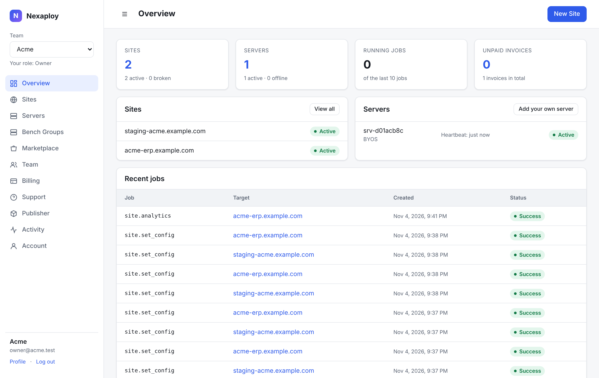

# Nexaploy

Nexaploy is a hosting and management platform for **Frappe / ERPNext**: a small,
focused alternative to Frappe Cloud. You can run sites on servers the platform creates for
you, or **bring your own server** (BYOS) and let Nexaploy manage it.



## What it does

- **Several Frappe versions side by side.** v14, v15 and v16 run on the same server. Each
  version and app set has its own *bench*, built from a *Release Group* (Frappe major + apps).
- **Sites.** Create sites, install apps, add custom domains with automatic TLS, edit the
  site config, migrate, back up, restore, create staging copies, rename, move to another
  bench or server, upgrade to a newer Frappe major, and transfer to another team.
- **Backups** to S3-compatible storage, on a schedule or by hand. Files have checksums,
  old backups are removed by a retention rule, and you get short-lived download links.
- **Marketplace.** Apps declare which Frappe majors they support. There are paid apps,
  publishers and payouts. You can also add your own apps from GitHub.
- **Operations.** Server metrics, alerts (disk, offline, unhealthy containers), uptime
  checks, automatic updates inside a time window, per-site usage with plan limits, logs,
  request analytics, slow queries, read-only SQL and a console.
- **Billing and teams.** Plans, invoices, Stripe and Paymob, prepaid credits. Teams have
  roles, 2FA, an activity log and API keys. The customer dashboard is in English and Arabic.

## How it fits together

```
 control plane (Frappe app "nexaploy")          your servers (hosted or BYOS)
 ┌──────────────────────────────────┐           ┌──────────────────────────────────────┐
 │ desk + customer dashboard        │  HTTPS    │ nexaploy-agent (API + worker)        │
 │ Agent Jobs ◄── poll / job_update ├◄──────────┤ Docker: Traefik · MariaDB 11.8       │
 │ heartbeat (facts, usage)         │ outbound  │ benches (one per Release Group)      │
 └──────────────────────────────────┘   only    │   └─ sites (own DB, files, domains)  │
                                                 └──────────────────────────────────────┘
```

- The **control plane** is a Frappe app. It stores servers, release groups, benches, sites,
  backups, plans and invoices. It never connects to a server.
- Each server runs the **agent**, `nexaploy-agent`. The agent always opens the connection
  to the control plane: it sends a heartbeat, asks for jobs, runs them step by step and
  reports the result. A server needs **no inbound ports except 80/443** for its sites, and
  no SSH access for the platform.
- Everything on a server lives in `/opt/nexaploy`. There is one shared MariaDB (`mariadb:11.8`)
  and one Traefik proxy. Each bench is its own Docker Compose project.
- **No lock-in.** If you remove the agent, your benches, sites, database and proxy keep running.

## Where to go next

- [Quick start](quick-start.md): everything on one server, or a hosted control plane with BYOS servers.
- [Install reference](install.md): every `install.sh` option.
- [Operating](operating.md): backups, updates, agent upgrades, moving sites, Frappe versions.
- [Troubleshooting](troubleshooting.md): TLS, ports, MariaDB, disk, failed jobs, logs.
- [Security model](security.md) and [FAQ](faq.md).

## New features { #new }

These features are being added now. Each line says what the feature does. Details will
be documented when the feature is released.

| Feature | What it does |
|---|---|
| **All-in-one install** | `install.sh --with-control-plane <domain>` installs the control plane and the sites on one server. |
| **Notifications / Telegram** | Sends alerts and job results to Telegram and other channels, not only by e-mail. |
| **Google Drive / OneDrive backups** | Lets you store backups in Google Drive or OneDrive as well as in S3. |
| **DNS verification** | Checks that a custom domain points to the right server before TLS is requested. |
| **Point-in-time recovery (PITR)** | Restores a site's database to a chosen moment, not only to the last backup. |
| **Safe updates** | Takes a backup and tests an update first, and goes back if the migration fails. |
| **Email relay** | Lets sites send outgoing e-mail through a relay the platform manages. |
| **White-label** | Puts your own brand on the customer dashboard. |
